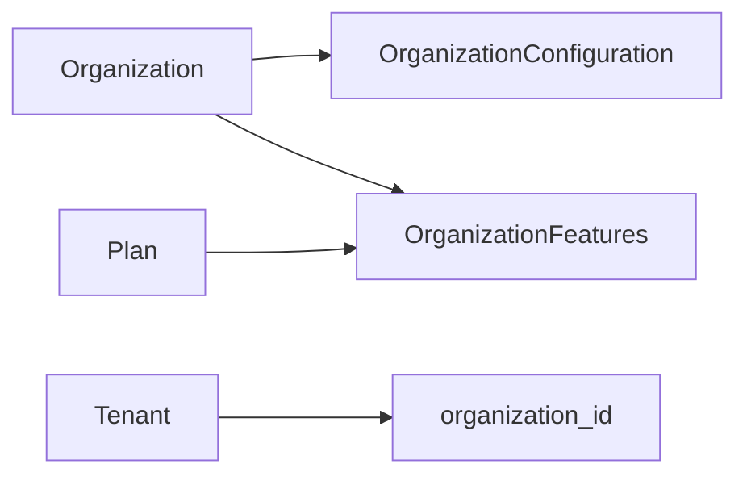

# Requirements

### Overview & Goals
Reorganizar conceptualmente los agregados para que `Organization` sea responsable de la identidad compartida y de la configuración funcional que actualmente pertenece a `Tenant`. Esta fase define el cambio de structs y tipos de dominio; no incluye todavía operaciones, repositorios ni endpoints.

### Scope
#### In Scope
- Mover `host` y `name` desde `Tenant` a `Organization`, incluyendo `NewOrganization`/`NewTenant` y las construcciones del dominio.
- Mover `logo` y `colors` a una configuración de organización y renombrar `TenantConfiguration` como `OrganizationConfiguration`.
- Eliminar de la configuración `theme` y `menu_type`.
- Trasladar `TenantFeatures` a organización con un nombre acorde al nuevo propietario (`OrganizationFeatures`).
- Hacer que `Organization.limits` no sea obligatorio en el contrato actual, o retirarlo si el modelo resultante no necesita representarlo todavía.
- Actualizar los métodos y validaciones de las entidades de dominio para que configuración y features se gestionen desde `Organization`, sin rediseñar ni trasladar menús.
- Mantener la compatibilidad conceptual de `organization_id`, plan, estado, registro, idiomas y demás propiedades que sigan siendo propias de `Tenant`.

#### Out of Scope
- Cambios en `src/data/access`, migraciones MongoDB, repositorios y persistencia.
- Cambios en `src/core/operation`, comandos de aplicación, handlers HTTP, mensajes y contratos de endpoints; se abordarán después de este refactor de structs.
- Definir todavía el reemplazo futuro de `OrganizationLimits` o sus reglas de negocio.

### Functional Requirements
- `Organization` y `NewOrganization` deben expresar la nueva responsabilidad y ser serializables con los tipos trasladados.
- `Tenant` y `NewTenant` no deben declarar `host`, `name`, configuración ni features como propiedades propias después del refactor; los menús quedan fuera de este cambio y no se modificarán.
- `OrganizationConfiguration` debe contener únicamente `logo` y `colors`; `theme` y `menu_type` dejan de formar parte del modelo.
- `Organization.limits` no debe bloquear la creación/deserialización de una organización mientras la definición definitiva de límites queda pendiente.
- Las pruebas de serialización/deserialización y validación deben reflejar los nombres y el propietario nuevos.

# Technical Design

### Current Implementation
- `src/core/domain/organization/organization_type.rs:6-27` define `Organization`, `OrganizationLimits` y `NewOrganization`; actualmente exige `limits` y sólo contiene nombre, plan y estado.
- `src/core/domain/tenant/tenant/tenant_type.rs:6-23` define `TenantColors` y `TenantConfiguration`, incluyendo `theme` y `menu_type`; `Tenant` y `NewTenant` mantienen `host`, `name`, configuración, features y `menus` en `tenant_type.rs:26-45` y `84-101`.
- `src/core/domain/tenant/menu.rs` y la lógica de menús de `src/core/domain/tenant.rs:156-231` existen actualmente, pero quedan explícitamente fuera del refactor y no se moverán ni modificarán.
- `src/core/domain/tenant.rs:1-9` registra los módulos; `TenantEntity` gestiona configuración/features (`80-87`) y filtrado por features (`104-150`), que sí se revisarán para el nuevo propietario.
- `src/core/domain/organization.rs:15-27` construye la organización y deberá incorporar los nuevos datos, mientras sus métodos actuales sólo actualizan nombre, estado y plan.
- Las referencias a estos contratos también aparecen en `src/core/commands/tenant_command.rs`, `src/core/operation/tenant_ops.rs`, `src/handlers/messages/*` y `src/handlers/http/tenant/tenant_routes.rs`; se catalogarán pero no se modificarán en esta fase.

### Key Decisions
- `Organization` será el agregado propietario de `OrganizationConfiguration` y `OrganizationFeatures`; los menús no forman parte de esta decisión y permanecen en su diseño actual hasta una fase posterior específica.
- `Tenant` conservará sólo estado, registro, plan opcional, idiomas y `organization_id`, salvo que una revisión posterior indique otra propiedad explícitamente propia.
- `limits` se modelará como opcional (`Option<OrganizationLimits>`) o se eliminará del struct si no hay consumidores de dominio que lo necesiten; la implementación debe elegir la alternativa que minimice el contrato obligatorio sin inventar reglas futuras.

### Proposed Changes
- Reubicar `TenantColors` como `OrganizationColors` y `TenantConfiguration` como `OrganizationConfiguration`, conservando `logo` y `colors` y eliminando `theme`/`menu_type`.
- Renombrar `TenantFeatures` a `OrganizationFeatures` y trasladar `validate_against_plan` al módulo de organización, ajustando el error sólo si el contrato de error deja de ser semánticamente correcto.
- Añadir a `Organization`/`NewOrganization` los campos trasladados y `host`, y retirar de `Tenant`/`NewTenant` los campos que cambian de propietario.
- Mover a `OrganizationEntity` únicamente la construcción, actualización y validación de configuración/features que hoy corresponda a `TenantEntity`; dejar intactas las operaciones de menú.
- Actualizar las pruebas inline de `src/core/domain/tenant/tenant_type.rs` para que no dependan de `theme`/`menu_type` y añadir cobertura del nuevo contrato de organización.
- Mantener una lista explícita de referencias pendientes en operaciones, repositorios, mensajería y rutas para la segunda fase, sin cambiar sus APIs ahora.

### Architecture Diagram

### Risks
- Quitar campos de `Tenant` rompe temporalmente constructores y consumidores de capas superiores; se acepta porque esas capas quedan fuera de esta fase y deberán actualizarse después.
- Las referencias de menús deben permanecer sin cambios para evitar mezclar este refactor con el diseño alternativo que se realizará posteriormente.
- Cambiar el nombre de features puede afectar el contrato JSON; conservar `serde`/aliases sólo si se necesita compatibilidad de datos existente, decisión que deberá validarse al implementar persistencia.

# Testing

### Validation Approach
- Ejecutar la compilación y los tests del crate después de ajustar únicamente los tipos y entidades de dominio; los fallos causados por capas aún no migradas se registrarán como trabajo de la siguiente fase.
- Verificar mediante serde que `Organization` acepta configuración, features y ausencia de límites obligatorios según la decisión final, sin añadir casos para menús.

### Key Scenarios
- Deserializar una organización con `logo`, `colors` y features bajo sus nuevos nombres.
- Confirmar que `theme` y `menu_type` ya no forman parte del contrato de configuración.
- Crear un tenant sin campos trasladados y conservar `organization_id`, estado, plan, registro e idiomas.
- Validar features de organización contra `PlanFeatures`.
- Crear/deserializar una organización sin `limits`.

### Test Changes
- Migrar las pruebas existentes de `src/core/domain/tenant/tenant_type.rs:108-191` al contrato nuevo o reemplazarlas por pruebas en el módulo de organización.
- Añadir pruebas de configuración y validación de features en `OrganizationEntity`; no añadir ni modificar pruebas de menús.

# Delivery Steps

### ✓ Step 1: Redefinir los contratos de Organization y Tenant
Los structs de organización y tenant reflejan la nueva propiedad de identidad y configuración, sin alterar menús.
- Actualizar `src/core/domain/organization/organization_type.rs` con `host`, configuración, features y límites no obligatorios.
- Renombrar los tipos de configuración y features y eliminar `theme`/`menu_type`.
- Retirar de `Tenant` y `NewTenant` los campos trasladados, manteniendo sus datos propios.
- Ajustar serde, derives y pruebas de deserialización del contrato.

### ✓ Step 2: Trasladar configuración y features a Organization
La entidad `OrganizationEntity` gestiona configuración y features sin depender del dominio tenant.
- Trasladar la construcción, actualización y validación de configuración/features desde `TenantEntity` a `OrganizationEntity`.
- Adaptar la validación de features para consultar `OrganizationFeatures`.
- No modificar `src/core/domain/tenant/menu.rs`, las operaciones de menús ni sus reglas actuales; se rediseñarán posteriormente.

### ✓ Step 3: Actualizar validación del dominio y dejar interfaces superiores para la siguiente fase
El modelo de dominio queda validado y las dependencias externas quedan identificadas sin modificar operaciones, repositorios ni endpoints.
- Actualizar tests inline y añadir cobertura para configuración, features y ausencia de `limits`.
- Ejecutar compilación/tests del dominio y documentar las referencias pendientes en `src/core/operation`, `src/data/access`, `src/handlers` y comandos.
- No cambiar repositorios, migraciones, operaciones, mensajería ni rutas; esas adaptaciones se realizarán después sobre los contratos ya estabilizados.

### ✓ Step 4: Migrar repositorios y operaciones
Actualizar repositorios, comandos y operaciones para consumir los contratos actuales, manteniendo fuera el rediseño de menús.
- Eliminar filtros y lecturas de `host`, `name`, configuración y features desde `Tenant`.
- Gestionar configuración y features mediante `OrganizationOps` y `MongoOrganizationRepo`.
- Mantener en `TenantOps` únicamente las reglas propias del tenant y sus datos actuales.

### ✓ Step 5: Exponer endpoints de Organization
Añadir el acceso protegido por `id` y el acceso público por `host` para que el frontend pueda resolver la organización al cargar un subdominio.
- Mantener protegido `GET /api/organization/{id}` con `ORGANIZATION_READ_OWN`.
- Añadir `GET /api/organization/host/{host}` sin autenticación para resolver la organización por host.
- Incorporar la búsqueda por host en repositorio y operación, sin modificar menús ni endpoints de tenant.

### ✓ Step 6: Añadir búsquedas por plan y organización
Exponer la búsqueda de una organización por `plan_id` y de tenants por `organization_id`.
- Añadir las consultas correspondientes en repositorios y operaciones.
- Añadir los endpoints HTTP manteniendo las protecciones existentes.